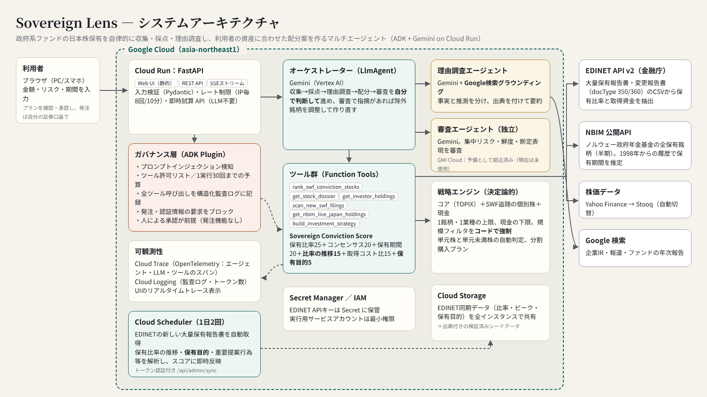

# Sovereign Lens

世界の政府系ファンドが選んだ日本株を、あなたの資産サイズで。

サウジアラビアのPIF、シンガポールのGIC、ノルウェーのNBIMなど、政府系ファンド（SWF）が保有する日本株を集めます。エージェントが保有比率・推定取得単価・保有期間・購入理由を調べ、利用者の金額・リスク許容度・投資期間に合わせた配分案（株数と買い方まで）を作ります。

第5回 Agentic AI Hackathon with Google Cloud への応募作品です。



## 主な機能

| 機能 | 内容 |
|---|---|
| SWF保有の収集 | EDINET API v2 の大量保有報告書・変更報告書（docType 350/360）と、NBIM公開APIの全保有銘柄から集めます。出典URL付きの検証済みデータ（43件）も同梱しています。 |
| 推定取得単価 | 報告書の「取得資金合計 ÷ 保有株数」を、株式分割で調整して算出します。 |
| 保有期間 | 初回報告日と、NBIMの1998・2005・2010・2015・2020年末の保有一覧から推定します。 |
| Sovereign Conviction Score | 保有比率25点、複数ファンドの重なり20点、保有期間20点、**比率の推移15点**（どれだけ買い増したか／ピークからどれだけ売ったか）、現在値と取得コストの比較15点、**保有目的5点**の合計です。 |
| 購入理由の調査 | Gemini と Google検索グラウンディングを使い、事実と推測を分けて出典付きで要約します。 |
| 戦略の作成 | コア（TOPIX）、SWF追随の個別株、現金に分けます。単元株か単元未満株かを判定し、分割購入の計画も付けます。 |
| 独立審査 | 別のエージェントが集中リスクや断定的な表現をチェックします。指摘があれば、オーケストレーターが自分で作り直します。 |

## v2で追加した機能

- **物言う株主（別カテゴリ）**：日本で実績が明確な大手アクティビスト（村上系・エフィッシモ・オアシス・エリオット・バリューアクト・3D）の5%超保有も追跡します。戦略に含めるかどうかはスイッチで選べます。
- **資金調達型の警告**：EVO FUNDなどMSワラントの引受け先が持つ銘柄には警告を出し、戦略には入れません。
- **買い時判定**：ファンドの推定取得単価との差、52週高値からの下落率、200日移動平均との乖離、ファンドの直近の売買を合わせて0〜100点で判定し、「買い場候補／分割で買い／様子見／見送り」に分けます。
- **保有管理**：買った銘柄を記録して、損益・前日比・ファンドの売り動向を確認できます（データはブラウザ内にだけ保存し、サーバーには送りません）。
- **比率の推移と保有目的**：大量保有報告書の「直前の保有割合」「保有目的」「重要提案行為等」を解析します。買い増しが大きいほど加点、ピークの半分以下まで売られた銘柄は戦略から外します。保有目的は「純投資／重要提案行為等／経営関与／政策投資・提携／資金調達の引受け」に分類します。
- **EDINET自動同期**：Cloud Scheduler が1日2回 `/api/admin/sync`（トークン認証）を呼び、新しい報告書を取り込んで Cloud Storage に保存します。全インスタンスが読み込むので、再デプロイなしでスコアと戦略に反映されます。
- **速度**：レポートを書いた部分から順に表示（ストリーミング）し、配分はツールの結果が出た時点で表示します。購入理由の調査結果は12時間キャッシュします。

## エージェント設計

- `sovereign_lens`（オーケストレーター、ADK `LlmAgent`）：収集→採点→理由調査→配分→審査の手順を、状況を見ながら自分で進めます。
- `rationale_researcher`：`google_search` ツールを持つサブエージェントです。`AgentTool` として呼び出します。
- `plan_reviewer`：独立した審査エージェントです。プランの数値は変更できません。現在は Gemini で動かしています。
  - ※ **GMI Cloud（DeepSeek-V4-Pro などの別系統モデル）は予備として組み込んであるだけで、現在は使用していません。** `REVIEWER_PROVIDER=gmi` と `GMI_API_KEY` を設定すると審査役を切り替えられ、応答がないときは自動でGeminiに戻ります。
- モデル：オーケストレーターと理由調査は **Gemini 3.8 Flash**（思考レベルLOW）。起動時に利用可能性を確認し、3.8 → 3.7 → 3.6 → 2.5 の順で自動フォールバックします。
- 数値はすべて決定論的なツール（`build_investment_strategy`）が計算します。LLMが数字を作ることはありません。

## ガバナンス・セキュリティ・可観測性

- **ADK Plugin（`GovernancePlugin`）**
  - プロンプトインジェクションと、発注・認証情報の要求を検知してブロックします。
  - ツールは許可リストにあるものだけ呼べます。1回の実行で呼べるのは30回までです。
- **ガードレール**：1銘柄・1業種の上限、現金比率の下限、リスク別の銘柄規模フィルタはコードで強制します。テストは54件です。
- **発注機能なし**：プランは人が確認・承認する前提です（CSVの発注メモを出力します）。
- **コスト管理**：IPごとのレート制限、Cloud Run の最大インスタンス数3、最小0（使わないときは課金されません）。
- **可観測性**：Cloud Trace（OpenTelemetry）、Cloud Logging の構造化監査ログ（`jsonPayload.audit=true`）、UIでのリアルタイムトレース表示。
- **最小権限**：EDINETキーと同期用トークンは Secret Manager に保管し、実行用サービスアカウントの権限は最小限にしています（Cloud Storage はバケット単位の権限のみ）。

## デプロイ（Google Cloud Shell）

```bash
git clone https://github.com/yasuhitoyanagisawa/sovereign-lens.git
cd sovereign-lens
chmod +x deploy.sh
./deploy.sh <PROJECT_ID> [EDINET_API_KEY]
```

`deploy.sh` は Cloud Run のデプロイに加え、Cloud Storage バケット、同期用トークン、Cloud Scheduler ジョブ（毎日 7:30 / 19:30 JST）も作成します。

## 謝辞

アイデアは、げんたろうさんの動画（https://www.youtube.com/watch?v=TrZe0hfZB3Q ）と、あい先生のYouTubeチャンネル「あい先生の株式投資教室」（https://www.youtube.com/@あい先生の株式投資教室 ）を参考にしています。

## ローカル実行

```bash
pip install -r requirements.txt pytest
pytest                       # LLMなしで54件のテストが通ります
export GOOGLE_GENAI_USE_VERTEXAI=true GOOGLE_CLOUD_PROJECT=<id> GOOGLE_CLOUD_LOCATION=global
uvicorn app.main:app --reload --port 8080
```

## 免責事項

本ソフトウェアは公開情報に基づく情報提供を目的としたもので、投資助言・勧誘ではありません。推定取得単価は報告書の取得資金から計算した推定値です。データの正確性は保証しません。
