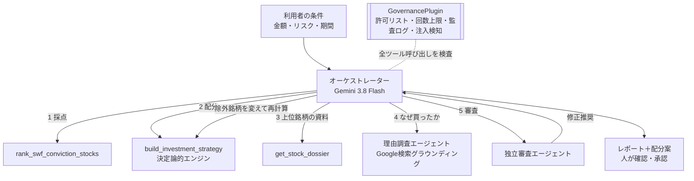

## はじめに

**Sovereign Lens** は、ノルウェー政府年金基金（NBIM）・サウジアラビアPIF・シンガポールGICなど、世界の政府系ファンドが買った日本株をAIエージェントが追いかけ、**あなたの金額・リスク・期間に合わせた投資戦略（何を、何株、どう買うか）** に変えるサービスです。

- デモ：https://sovereign-lens-mhdvlbrwja-an.a.run.app （ログイン不要）
- GitHub：https://github.com/YasuhitoYanagisawa/sovereign-lens

*300万円・バランス型で実行した結果。即時試算が数秒で出て、エージェントのレポートが書けた順に流れてきます*

この記事で伝えたいことは3つです。

1. **課題**：プロの投資の「足跡」は公開されているのに、個人には使える形で届いていない
2. **エージェントらしさ**：収集→採点→理由調査→配分→独立審査を、エージェントが状況を見て自分で進め、審査で指摘されれば自分で作り直す。その自律性を、コードのガードレール・監査ログ・人の承認で制御する
3. **検証**：過去のある日にこの戦略どおり買っていたら、今いくらになっていたか。1年前に300万円なら382.9万円、3年前なら564.6万円でした（ただし全額TOPIXには届かず、その理由まで分解しました）

## 1. 背景：プロの足跡は、実は公開されている

着想のもとは、次の2つのYouTubeです。

- げんたろうさんの動画 
  https://www.youtube.com/watch?v=TrZe0hfZB3Q
- あい先生のチャンネル「あい先生の株式投資教室」 
  https://www.youtube.com/@あい先生の株式投資教室

「実績のあるプロが何を、いくらで、なぜ買ったのかを手がかりにする」という考え方を、エージェントに任せられる形にしたのがこのプロジェクトです（内容の解釈と実装は筆者によるものです）。

調べてみると、材料はそろっていました。

- **EDINETの大量保有報告書**：5%を超えて株を持つと、保有比率・取得資金・**保有目的**を報告する義務があります。比率が1%以上動くたびに変更報告書も出ます。
- **NBIMの全保有銘柄データ**：運用資産約2兆ドルのノルウェー政府年金基金は、日本株約1,400社を含む全保有を公開しています。1998年からの履歴もあります。

## 2. 課題：「誰が持っているか」だけでは使えない

想定ユーザーは、**新NISAをきっかけに日本株の個別銘柄を買い始めた会社員**です。資金は数十万〜数千万円で、「何を、いくらで、何株買えばいいのか」の根拠がほしい人です。

この人にとって、生の開示情報には4つの壁があります。

| 壁 | 具体的には |
|---|---|
| 分散している | 報告書はXBRL/CSV/PDF、NBIMは英語のJSON。毎日どこかで新しい報告が出る |
| 情報が足りない | 知りたいのは「いくらで買ったか」「まだ買い増しているか、売り始めたか」「なぜ買ったか（純投資か、経営に提案するつもりか）」「今は買い時か」 |
| 真似ると偏る | PIFの日本株は任天堂・カプコン・ネクソンなどゲーム株に集中。そのまま真似ると業種が大きく偏る |
| 罠がある | MSワラントの引受け先（資金調達型）が5%超を持つ銘柄は、市場で売るのが前提。「大株主＝良いサイン」ではない |

## 3. ソリューション：Sovereign Lens でできること

### 使い方（3ステップ）

1. 左の「あなたの条件」に金額・リスク許容度・投資期間を入れ、「エージェントに戦略を組ませる」を押す
2. 数秒で**即時試算**（LLMを使わない配分計算）が表示され、右のトレースでエージェントの動きが見える。レポートは書けた順に流れ、1〜2分で完了
3. 配分案を確認し、CSVの発注メモを保存。**発注はしません**。自分の証券口座で実行します

### 銘柄ごとの「なぜ」が見える

「ファンド保有銘柄」タブでは、全銘柄を **Conviction Score（100点満点）** と **買い時判定** で並べています。

| 要素 | 配点 | 見ていること |
|---|---|---|
| 保有比率 | 25 | ファンドがどれだけ本気で持っているか |
| コンセンサス | 20 | 複数のファンドが重ねて持っているか |
| 保有期間 | 20 | 何年持ち続けているか |
| **比率の推移** | 15 | どれだけ買い増したか／ピークからどれだけ売ったか |
| 取得コスト比 | 15 | 今の株価がファンドの推定取得単価より安いか |
| **保有目的** | 5 | 純投資／重要提案行為等／経営関与／政策投資／資金調達の引受け |

*行をクリックすると、保有比率の推移・保有目的の原文・推定取得単価・買い時判定の理由・出典PDFが開きます*

買い時判定は、推定取得単価との差、52週高値からの下落率、200日移動平均との乖離、ファンドの直近の売買から0〜100点で出し、「買い場候補／分割で買い／様子見／見送り推奨」に分けます。スコアが高くても株価が上がりすぎていれば「様子見」になります。

そのほかの機能です。

- **物言う株主（別カテゴリ）**：村上系・エフィッシモ・オアシス・エリオット・バリューアクト・3Dなど、日本で実績が明確なアクティビストも追跡。戦略に入れるかはスイッチで選べます
- **警告対象**：EVO FUNDなど資金調達型が持つ銘柄は「買わない方がよい」と表示し、戦略には絶対に入れません
- **保有管理**：買った銘柄を記録すると、損益と「ファンドが売り始めた」アラートが見られます（データはブラウザ内だけに保存）
- **過去で検証**：後述のバックテストを、自分の条件で誰でも実行できます

## 4. エージェント設計：自律させる部分と、させない部分

### 全体の流れ

ADK（Agent Development Kit）で、3つのエージェントを `AgentTool` でつないでいます。

- **オーケストレーター**：手順を自分で計画して進めます。例えば審査役から「ゲーム株に偏っている」と指摘されると、どの銘柄を外すかを自分で決め、`exclude_codes` を付けて配分を作り直します。
- **理由調査エージェント**：`google_search` だけを持つサブエージェントです。「なぜPIFはこの会社を買ったのか」を、事実と推測を分けて出典付きで要約します。
- **独立審査エージェント**：プランの数値は変えられず、集中リスク・情報の鮮度・断定的な表現だけを審査します。

### 判断を変える材料は、データから来る

オーケストレーターが自分で判断を変える場面を、ルールではなくデータで作っています。

- **比率の推移**：ピークの半分以下まで売られている銘柄（例：ある物言う株主が43%→7.6%まで売却）は「大きく売却中」として候補から外れ、レポートでも理由を説明します
- **保有目的**：「重要提案行為等」があるアクティビストの保有は、増配・自社株買い・TOBなどのイベントが起きやすいことをレポートで説明します
- **警告対象**：資金調達型が持つ銘柄は、利用者が求めても候補に入りません

### 自律性を制御する仕組み

| 仕組み | 内容 |
|---|---|
| 数字はLLMに作らせない | 配分・株数・上限チェックはPythonの決定論的ツールが計算。1銘柄・1業種の上限、現金の下限、リスク別の規模フィルタをコードで強制し、全組み合わせをテスト |
| ADK Plugin | `GovernancePlugin` で全ツール呼び出しを検査。許可リスト、1実行あたりの呼び出し上限（審査2回・配分2回・理由調査3回まで）、プロンプトインジェクションと発注・認証情報の要求をブロック |
| 人の承認 | 発注機能そのものを持たない。プランは人が確認し、CSVの発注メモを自分の口座で実行 |
| 可観測性 | Cloud Trace（エージェント・LLM・ツールのスパン）、Cloud Logging の構造化監査ログ、画面上のリアルタイムトレース |
| 速度とコスト | 理由調査を銘柄単位で12時間キャッシュ。思考レベルLOWで、完了まで1〜2分（混雑時は自動でモデルを切り替え） |

なお、審査役は「同じモデル系統どうしで誤りを見逃す」ことを避けるため、GMI Cloud上の別系統モデルにも切り替えられるように作りました。ただし **GMI Cloudは予備として組み込んだだけで、現在は使っていません**（審査もGeminiで行っています）。

## 5. データパイプライン：EDINETを1日2回、自動で読む

大量保有報告書は随時提出されるので、Cloud Scheduler が1日2回（7:30と19:30）、トークン認証付きの同期エンドポイントを呼びます。

1. 追跡しているファンドの新しい報告書をEDINET API v2で探す
2. CSVから、要素IDで値を取り出す
   - `HoldingRatioOfShareCertificatesEtc`（保有割合）と `...PerLastReport`（直前の保有割合）
   - `TotalAmountOfFundingForAcquisition`（取得資金合計）、`TotalNumberOfStocksEtcHeld`（保有株数）
   - `PurposeOfHolding`（保有目的）、`ActOfMakingImportantProposalEtc`（重要提案行為等）
3. 初回比率・ピーク比率・履歴と合わせて Cloud Storage に保存
4. 全インスタンスがそれを読み込み、**再デプロイなしで**スコア・買い時判定・戦略に反映

過去1年分の報告書を取り込み、31件のポジションを最新の比率と保有目的で更新しました。

## 6. システム構成

| サービス | 役割と選んだ理由 |
|---|---|
| Cloud Run | FastAPI（Web UI・REST・SSE）。最小0インスタンスで、使わないときは課金されない。最大3インスタンスでコスト上限を固定 |
| Vertex AI（Gemini 3.8 Flash） | 起動時に利用可能なモデルを確認。実行中も、混雑（429や応答開始の遅れ）を検知すると3.8→3.7→3.6→2.5の順に自動で切り替え |
| Cloud Scheduler＋Cloud Storage | EDINETの定期同期と、その結果をインスタンス間で共有 |
| Secret Manager／IAM | EDINETキーと同期トークンを保管。実行用サービスアカウントは最小権限 |
| Cloud Trace／Cloud Logging | エージェントの各ステップと監査ログ |

## 7. 検証：この戦略で運用していたら、いくら増えたか

「過去のある日に、この戦略どおり買っていたら今いくらか」を、アプリの **「過去で検証」タブ** で誰でも再現できるようにしました。

### 方法

- 開始日時点で**報告済み（初回報告日が開始日以前）の保有だけ**を使い、それ以降の売買情報は使わない
- 開始日までの株価で採点・買い時判定をし、**本番と同じ配分エンジン**で銘柄と株数を決める
- 開始日に一括で買い、今日（2026年10月14日）まで持ち続けた場合を、配当込みの株価（調整後終値）で評価
- 比較対象は2つ：①全額TOPIX（1306）、②同じ配分（コア45%・個別株約49%・現金約6%）のまま、個別株部分だけTOPIXに置き換えた場合

条件は、300万円・バランス型・政府系ファンドのみ（物言う株主スイッチOFF）です。

### 結果

| 開始日 | 300万円が今… | この戦略 | 同じ配分でTOPIX | 全額TOPIX | 最大下落（戦略／TOPIX） |
|---|---|---|---|---|---|
| 1年前（2025/10/14） | **382.9万円**（+82.9万円） | +27.6% | +31.8% | +33.7% | -6.6% ／ -8.6% |
| 2年前（2024/10/15） | **446.4万円**（+146.4万円） | +48.8% | +54.4% | +58.0% | -11.1% ／ -12.2% |
| 3年前（2023/10/16） | **564.6万円**（+264.6万円） | +88.2% | +88.0% | +93.5% | -15.7% ／ -18.1% |

**どの期間でもしっかり利益は出ましたが、全額TOPIXには届いていません**。正直な結果です。現金を約6%持つ設計なので、上昇相場では全額TOPIXに負けやすい面もあります。一方で、最大下落はどの期間もTOPIXより小さく抑えられています。

### 中身を分解すると、はっきりした傾向がある

個別株を「どのファンドに追随したか」で分けると、差がはっきり出ました（各銘柄の騰落率の単純平均）。

| 開始日 | ノルウェーNBIMの保有銘柄（7銘柄） | サウジPIFが関わるゲーム株（3銘柄） | TOPIX |
|---|---|---|---|
| 1年前 | **+49.2%** | -17.2% | +33.7% |
| 2年前 | **+66.6%** | +12.2% | +58.0% |
| 3年前 | **+137.7%** | +19.0% | +93.5% |

- NBIMの銘柄（みずほFG・SOMPO・日立・リクルートなど）は、**どの期間でもTOPIXを大きく上回りました**。3年前に買っていれば、みずほFGは+254.9%、日立は+233.0%です。
- 一方、PIFのゲーム株（任天堂・ネクソン・コーエーテクモ・スクウェア・エニックスのうち各期間の3銘柄）が足を引っ張りました。直近1年では任天堂が-31.9%です。
- 物言う株主スイッチをONにした場合（1年前から）は+19.4%で、OFFより低い結果でした。

「どのファンドに、どの業種で追随するか」で成績が大きく変わることが、データで確認できました。今後は、ファンドごとの過去の追随成績をスコアに反映させたいと考えています（ただし過去に合わせすぎないよう、期間を分けて検証します）。

### 注意点（バイアス）

- 保有比率・推定取得単価は最新の報告値を使っています。また追跡するファンドと銘柄は現時点で選んでいるため、**生存者バイアス**が残ります。
- 手数料・税金・分割購入は考慮していません。
- 過去の成績は将来の成果を保証しません。

## 8. 工夫と苦労

- **取得単価の推定**：報告書の「取得資金合計 ÷ 保有株数」を株式分割で調整して求めます。ただしNBIMの取得資金には貸株などの回転が含まれるため、単価の推定には使えません。システムでは「推定不可」と明示しています。
- **実データで確かめる**：EDINETのCSVは、合算値と保有者ごとの値がコンテキストで分かれています。要素名の推測ではなく、実際の報告書を開いて要素IDを確認してからパーサーを書き直しました。
- **データの罠**：PIFのゲーム株は2026年1月、グループ会社へ無対価で移管されていました。これを「売却」と誤判定しないよう、保有主体の変更として扱っています。
- **モデルの混雑**：締切前日の夜、Gemini 3.8 Flash が混雑して応答開始に1分以上かかり、429で失敗する事態が起きました。そこで、ADKの `BaseLlm` を継承したラッパーで「429／応答開始が15秒を超えたら次のモデルへ」切り替え、混雑したモデルは5分間避けるようにしました。
- **テスト**：ADKの `BaseLlm` を継承した「台本どおりに動く偽LLM」で、Runner→Plugin→ツール→セッション状態までをネットワークなしでテストしています（58件）。

## 9. 制約と今後

- **見えるのは5%超だけ**：ADIA・テマセクなどの5%未満の保有は大量保有報告書に出ません。全容を公開しているのはNBIMだけです。今後は米国の13F報告や各ファンドの年次報告にも広げたいと考えています。
- **バックテストのバイアス**：後述のとおり、保有比率の時点管理と、追跡ファンドの選び方に改善の余地があります。報告書の履歴を日付ごとに持てば、厳密な時点再現ができます。
- **審査役のマルチベンダー化**：GMI Cloudなど別系統モデルでの審査は予備として組込済みなので、残高を確保できれば切り替えて精度を比較します。

## おわりに

政府系ファンドの長期目線を、すべての個人投資家に。Sovereign Lens は、そのための「レンズ」です。

着想をくださった、げんたろうさん、あい先生に感謝します。

- デモ：https://sovereign-lens-mhdvlbrwja-an.a.run.app
- GitHub：https://github.com/YasuhitoYanagisawa/sovereign-lens

※ 本記事とシステムは情報提供を目的としたもので、投資助言・勧誘ではありません。推定取得単価は報告書の取得資金から計算した推定値です。過去の成績は将来の成果を保証しません。
